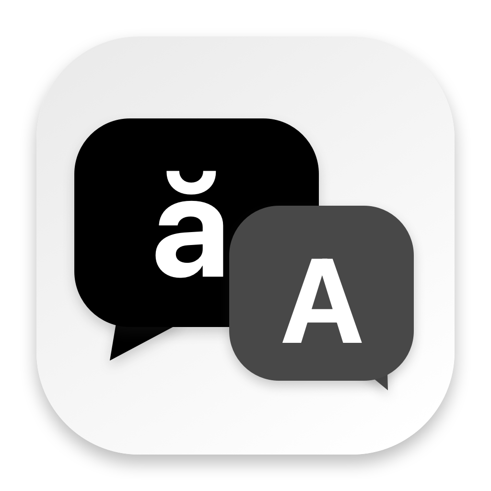
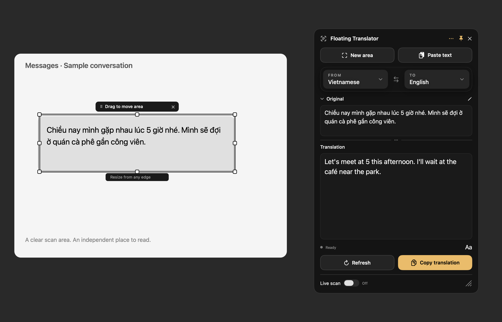

<p align="center">
  
</p>

<h1 align="center">Floating Translator</h1>

<p align="center">
  A tiny floating Mac tool for text that is hard to select or translate.<br>
  Select text or choose a screen area, and read the translation without leaving your current app.
</p>

<p align="center">
  <strong>macOS 15+</strong> · <strong>Swift</strong> · <strong>No API key</strong> · <strong>MIT licensed</strong>
</p>

Floating Translator starts with **Vietnamese → English**. You can also choose **Thai** or **Malay**, along with other languages supported by Apple's Translation framework. It lives in the Dock and has a compact **translation lens icon** in the menu bar while running.

## Installation

Requires **macOS 15 or later**. No account or API key is needed.

**Currently available as source code on GitHub.** There is no prebuilt app download yet; you need to build it on your Mac before installing it.

### Install in Applications

1. On this GitHub repository, click **Code → Download ZIP**, then extract the downloaded ZIP. You can also clone the repository with Git.
2. Follow [Build from source](#build-from-source) below. This creates **Floating Translator.app** inside the extracted repository's `build` folder.
3. Drag that app into **Applications**, then open it from there. Choose **New area** and draw a rectangle over the text you want to read.
4. If screen access is missing, click **Enable capture** in the results card. In **System Settings → Privacy & Security → Screen Recording**, enable **Floating Translator**. On some macOS versions, this setting is called **Screen & System Audio Recording**.
5. Quit and reopen the app if macOS asks, click **New area**, and drag a rectangle over the text. **Refresh** reads it again; turn on **Live scan** only when you want repeated scans.

**Screen access is only needed for area capture.** Selected-text Services and **Paste text** work without it.

Click the translation lens icon in the menu bar or press **⌥⌘T** to show or hide the window. Apple may ask to download translation languages on first use. **Paste text** works without screen access.

### Updating

Download or pull the latest source from GitHub and run `./build.sh` again. Quit the running app using **Quit**, replace the copy in **Applications** with the newly built app, and reopen it there. If access stops working, see [Permission troubleshooting](#permission-troubleshooting).

To open the app at login, add it in **System Settings → General → Login Items**.

## Preview

<p align="center">
  
</p>

Native UI preview with synthetic sample text. Choose an area in another app and read its translation in a separate card. Refresh to scan the same area again.

## Why I made it

I built this for my own everyday use. Sometimes I come across text inside an app or image that I cannot easily select, and switching to a translation website breaks my flow. I wanted a small window I could move over the words, read the translation, and then get back to what I was doing. I am sharing it in case it helps you too.

## Features

- An independent scan frame with a solid drag grip, eight resize handles, and a clear center that lets you click the source app.
- A resizable dark results card with a warm amber accent, a draggable Original/Translation divider, collapsible original text, and adjustable reading size.
- **New area**: draw a capture rectangle instead of positioning a large app window.
- **Translate with Floating Translator** in macOS Services for selected text, plus an explicit copied-text shortcut.
- Vietnamese → English by default, with Thai, Malay, and other available languages, plus a swap button.
- Paragraph formatting that joins wrapped OCR rows while keeping paragraph gaps, lists, headings, and short labels distinct. OCR grouping is heuristic; use **Edit original** to correct mistakes.
- **Refresh**, **Copy translation**, and a pin to keep results above other apps.
- Optional **Live scan**, off at launch. It pauses while you interact with the results card and skips retranslating unchanged text.
- On-device translation with no account or API key.

## How it works

### Capture an area

1. Click **New area** or press **⌥⌘N**. Drag a rectangle over text; press **Esc** to cancel.
2. The app reads that area once if screen access is already granted. Otherwise, use **Enable capture** in the results card.
3. Move the area using **Drag to move area**. Resize it from any edge or handle. The clear center lets you interact with the source app.
4. Read the independent results card. Drag its title bar to move it and its bottom-right grip to resize it. Drag the divider to change the space given to Original and Translation.
5. Click **Refresh** after changing the area. Optionally enable **Live scan** to read it every two seconds. Turn it off to freeze the result. Hiding the app or closing the scan frame stops Live scan.

The scan frame and results card stay visible during capture; ScreenCaptureKit excludes both from the captured image. The app preserves the previous translation while a new one is prepared.

### Translate selected or copied text

Select text in another app and choose **Services → Translate with Floating Translator**. The result opens directly in the card, with no scan frame or Screen Recording permission needed. Availability depends on the source app supporting macOS Services. You can enable the service or assign a shortcut in **System Settings → Keyboard → Keyboard Shortcuts → Services**. See [Apple's Services guide](https://support.apple.com/guide/mac-help/mchlp1012/mac).

For apps that do not expose Services, copy text and press **⌃⌥⌘T**, or click **Paste text**. The app reads the clipboard only when you invoke that action.

### Make reading comfortable

- Collapse **Original** to give the translation more room, or use the pencil to correct OCR and choose **Translate edit**.
- Use **Aa** to change text size. Text size, pane proportions, pin state, and window position are remembered.
- Use the pin to keep the card above other apps. The title-bar menu includes **Show last scan area** and **Quit Floating Translator**.
- Captured text and translations remain in memory; the app does not save a conversation history. Saved scan geometry contains only rectangle coordinates.

## Shortcuts

Click the menu bar lens icon or the Dock icon to open the results card.

| Shortcut | Action |
| --- | --- |
| ⌥⌘T | Show or hide the results card and active scan frame. Hiding stops Live scan. |
| ⌥⌘N | Draw a new capture area. |
| ⌥⌘R | Show the card and refresh the current area or text. |
| ⌥⌘A | Switch Live scan on or off for the current area. |
| ⌃⌥⌘T | Translate text you explicitly copied. |
| Return | Refresh while the results card is focused, except while editing. |
| ⌘Return | Translate your correction while editing the original. |
| Esc | Cancel area selection. |
| Services → Translate with Floating Translator | Translate a text selection from a supported app. |

Global shortcuts are registered only while the app runs and do not need Accessibility or Input Monitoring permission. If a shortcut is already in use, the buttons and menu bar remain available.

## Build from source

1. Install Apple's Command Line Tools if they are not already installed:

   ```sh
   xcode-select --install
   ```

2. Open Terminal in the extracted or cloned repository folder and run:

   ```sh
   ./build.sh
   ```

3. Find **Floating Translator.app** in the `build` folder, then follow [Install in Applications](#install-in-applications). Install it before the first launch and screen-access grant.

The build script handles local signing automatically. You do not need to create a certificate yourself or install third-party packages.

<details>
<summary>Developer notes: signing and public releases</summary>

The app uses Apple's AppKit, SwiftUI, Vision, ScreenCaptureKit, Translation, and Carbon frameworks.

Local builds reuse a persistent signing certificate. The first build creates a dedicated private keychain in `~/Library/Application Support/Floating Translator/Signing` and a user-level trust entry scoped to that certificate's code-signing use. Later builds reuse it so macOS can recognize updates as the same app. Keep this directory private, retain it across builds, and back it up. The private key is never placed in this repository.

If you have an Apple Development or Developer ID signing identity, set `CODESIGN_IDENTITY` instead:

```sh
CODESIGN_IDENTITY='your signing identity' ./build.sh
```

The local certificate is for development on your own Mac. Public binary releases should use Developer ID signing and notarization. Changing the signing certificate can require a fresh permission grant.

</details>

## Permissions and privacy

| Access | Why | When |
| --- | --- | --- |
| Screen Recording | macOS requires this to read pixels in another app. | Requested only when you click **Enable capture**. |
| Translation language download | Apple may need to install the chosen language models. | The first time you use a language pair. |

Opening the app and moving the lens do not request permission. The app first performs a passive access check. If permission is missing, area capture waits and the results card shows **Enable capture**. Click that button to authorize the app in System Settings. macOS may require you to quit and reopen after granting access. Once granted, choosing a new area scans once. Moving or resizing an existing area scans automatically only when Live scan is enabled. Paste text remains available even without screen access.

macOS may describe Screen Recording as **“screen and audio.”** Floating Translator sets audio capture off and does not request microphone, camera, Accessibility, or contacts access. It takes one display frame, crops it to the lens in memory, and discards the image after OCR. It does not save messages or screenshots. Translation runs through Apple's [on-device Translation framework](https://developer.apple.com/documentation/translation/translationsession).

## Permission troubleshooting

### Why did the permission dialog keep appearing?

During early development, local builds used **ad hoc signing**. Each rebuild changed the app's code identity, so macOS could stop associating it with the permission you had already granted. The Settings toggle could still show the old build as enabled. Repeated capture attempts then brought the dialog back. Apple explains this behavior in its [code identity documentation](https://developer.apple.com/documentation/technotes/tn3127-inside-code-signing-requirements).

The current build reuses a persistent certificate. The app also checks access before capturing, requests permission only through **Enable capture**, and pauses automatic capture when access is missing or declined. Switching from an old build to the new signing identity may require one fresh grant; ordinary updates using the same identity should retain it.

### Screen Recording is enabled, but capture is blocked

1. Quit all running copies using the app's **Quit** button. Closing the window can leave the menu bar app running.
2. Open the copy in **Applications**, then click **Enable capture** and check its Screen Recording setting. If the app is missing from the list, use **+** to add the installed copy. See [Apple's screen access guide](https://support.apple.com/guide/mac-help/control-access-to-screen-and-system-audio-recording-mchld6aa7d23/mac).
3. Quit and reopen the installed copy after changing access. For local builds, keep the signing directory above and use the same signing certificate for updates.

<details>
<summary>Advanced: clear an old grant or check access without capturing</summary>

If an old, mismatched grant remains stuck, quit the app and reset **only Floating Translator's** Screen Recording grant:

```sh
tccutil reset ScreenCapture dev.phyo.floatingtranslator
```

This removes its current grant. Reopen the installed app, click **Enable capture**, and approve it again. This is a recovery step, not part of routine installation or updates.

For a passive diagnostic without capturing or showing a window, quit the app first, then run:

```sh
open -a 'Floating Translator' --args --diagnose-screen-access
```

The result is written to `~/Library/Application Support/Floating Translator/capture-status.json`; it contains only the app path, version, and whether macOS grants screen access.

</details>

## Notes

- Keep the lens entirely on one display. If OCR misses small text, zoom the source app or use **Paste text**.
- Available language pairs depend on macOS support and installed models. The app checks the chosen pair before translating and explains when the current macOS version does not support it. Malay translation in particular may require a newer macOS release.
- The menu bar shortcut appears while the app runs. If macOS hides it because the menu bar is crowded, use the Dock icon to reopen the window.
- Live scan is optional, off at launch, and runs only for a visible scan area. It pauses while you interact with the results card; hiding the app stops it.

## Open source

Ideas, bug reports, and pull requests are welcome. See [CONTRIBUTING.md](CONTRIBUTING.md) for build and change notes. The icon and app code are included under the [MIT License](LICENSE).
